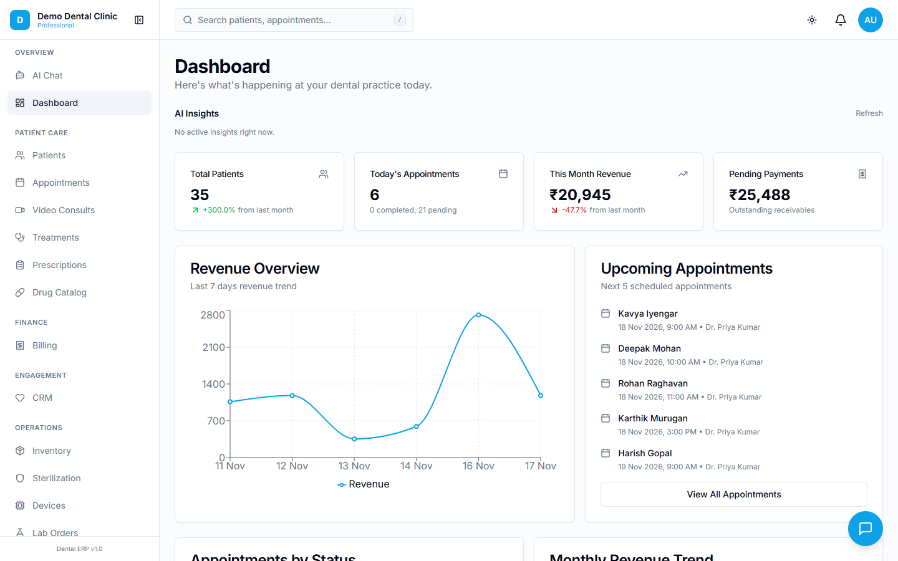
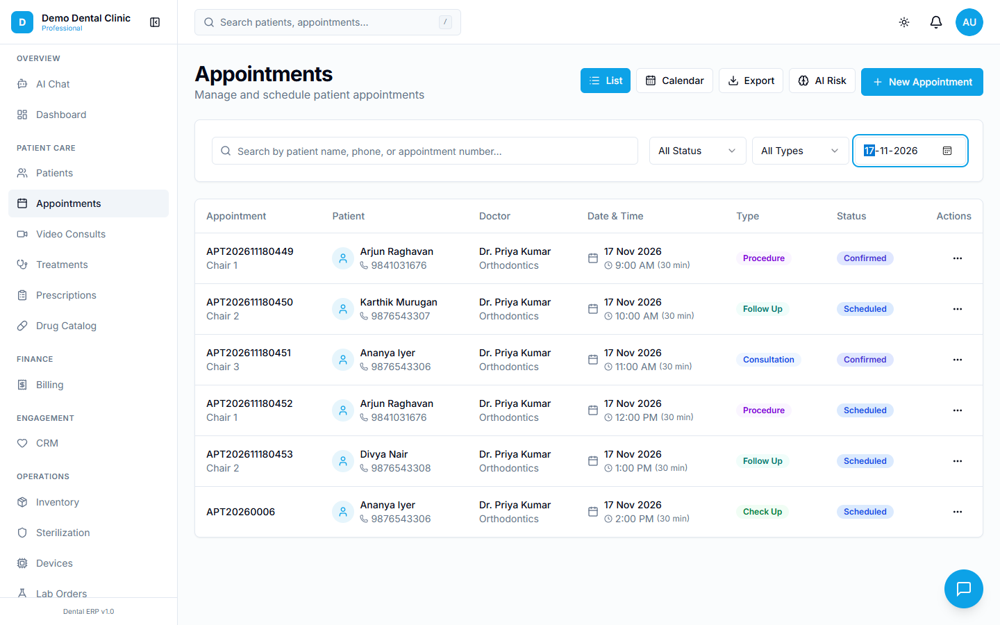
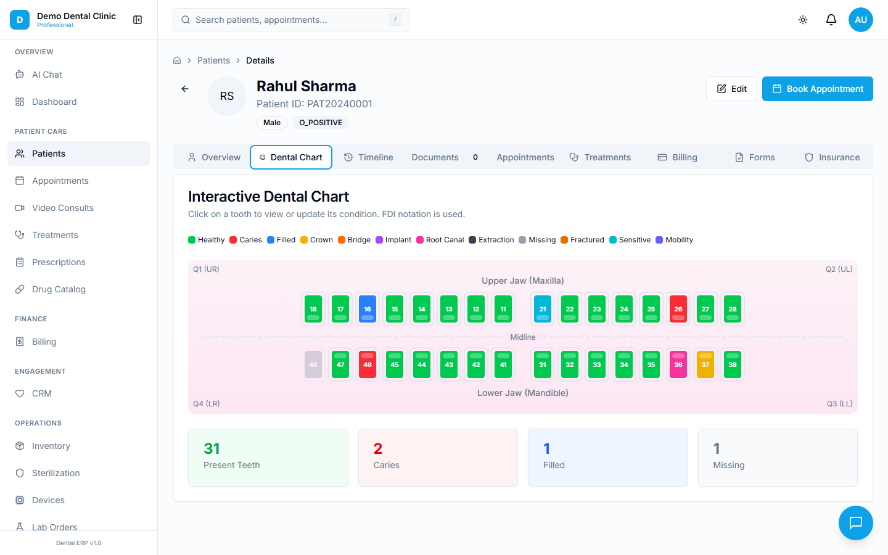
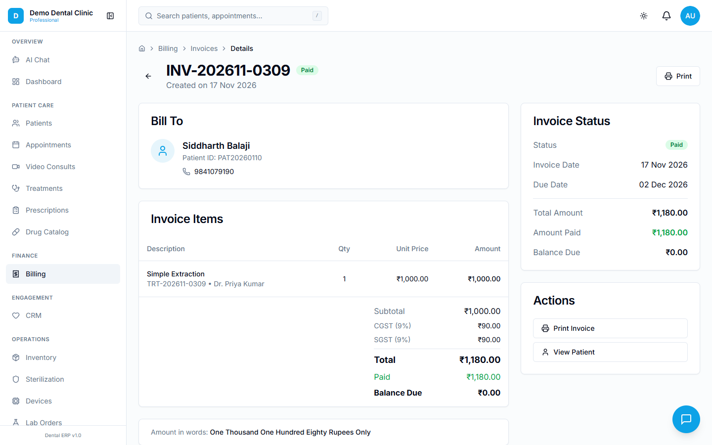
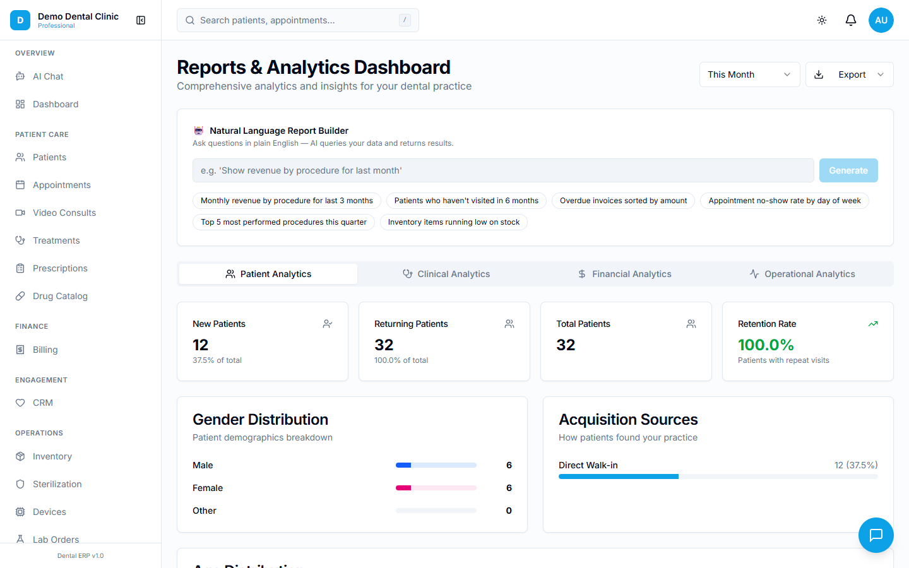

<div align="center">


# DentalERP

### Free, open-source dental clinic and hospital management software

AI-powered practice management for dental clinics in India and beyond: patient
records, dental charting, appointments, GST billing, a patient portal and
tele-dentistry. Self-hosted, so patient data stays on your own server.

[](https://github.com/abinauv/dental-erp/releases)
[](https://github.com/abinauv/dental-erp/actions/workflows/ci.yml)
[](https://github.com/abinauv/dental-erp/actions/workflows/codeql.yml)
[](https://github.com/abinauv/dental-erp/pkgs/container/dental-erp)
[](LICENSE)
[](https://github.com/abinauv/dental-erp/stargazers)

[Quick start](#quick-start) · [Features](#features) · [Screenshots](#screenshots) · [Self-hosting guide](SELF_HOSTING.md) · [FAQ](#faq) · [Changelog](CHANGELOG.md)

<br />

<picture>
  <source media="(prefers-color-scheme: dark)" srcset="docs/images/dashboard-dark.png" />
  
</picture>

</div>

## What is DentalERP?

DentalERP is a free, open-source practice management system for dental clinics
and multi-chair dental hospitals. It runs the whole clinic in one place: patient
records and medical history, an interactive dental chart, appointments, treatment
plans, prescriptions, GST-compliant invoices and payments, insurance claims, lab
orders, inventory, staff and reports, plus a patient portal and video
consultations. It is built with Next.js, Prisma and MySQL, ships as a Docker
image, and is released under the MIT license, so a clinic can run it on its own
server at no cost.

## Why DentalERP?

- **Free and open source.** MIT-licensed, with no per-seat fees, no feature
  tiers and no lock-in.
- **Your data stays with you.** You host it: on a small VPS, an office server or
  a Raspberry Pi (images for `amd64` and `arm64`).
- **Built for Indian clinics.** GST invoicing (CGST/SGST), amounts in words,
  Razorpay, PhonePe and Paytm payments, Indian SMS gateways, and the
  9 AM–9 PM rule for promotional SMS.
- **Ready for other countries.** EU VAT and US sales tax, US English and German,
  and per-clinic currency, time zone and date formats.
- **AI where it helps.** 15 built-in assistants, from treatment advice to
  no-show prediction and cash-flow forecasts, using OpenRouter, Anthropic or
  AWS Bedrock. Optional: everything works without them.
- **Built to run for years.** Database migrations on every upgrade, backup and
  restore scripts, health checks, and more than 4,600 automated tests with code
  scanning on every change.

## Features

### Clinical

- **Patient records**: demographics, medical history, allergies, documents and
  a full visit timeline
- **Interactive dental chart** (FDI notation) with conditions per tooth
- **Treatments and treatment plans** with a procedure catalogue and
  follow-ups
- **Digital prescriptions** with a medication catalogue, printable
- **Clinical forms and consent**, with AI-drafted consent forms
- **Video consultations** for tele-dentistry (Jitsi or Daily.co)
- **Sterilization tracking**: instruments, cycles and compliance logs

### Front desk

- **Appointments**: list and calendar views, chairs, check-in and check-out, a
  live queue and a waitlist
- **Online booking** and a **patient portal**: patients sign in with a one-time
  SMS code to see appointments, bills, prescriptions and records
- **Reminders and messages**: SMS (MSG91, TextLocal, Fast2SMS, Twilio) and email,
  sent now or scheduled for later, with templates and automations

### Billing and payments

- **Invoices** with GST, EU VAT or US sales tax, discounts, payment terms and
  printing
- **Payments** by cash, card, UPI and more; refunds; **online payment links**
  through Razorpay, PhonePe or Paytm
- **Payment plans** (EMI) with instalment tracking
- **Insurance**: policies, pre-authorizations and claims from submission to
  settlement
- **Billing reports**: revenue, collections and outstanding invoices by age

### Operations

- **Inventory**: stock levels, batches and expiry, suppliers, low-stock alerts
  and AI demand forecasts
- **Lab orders** with vendors, status history and documents
- **Staff**: roles and permissions, shifts, attendance and leave
- **Devices**: connected medical equipment and its readings
- **Reports and analytics**, with natural-language questions answered by AI
- **CRM**: patient segments, loyalty points, memberships and referrals

### AI assistants

Treatment advisor · Smart scheduler · No-show predictor · Patient intake ·
Billing agent · Insurance claim analyzer · Consent generator · Lab coordinator ·
Inventory manager · Inventory forecaster · Cash-flow forecaster · Patient
segmentation · Dynamic pricing · Clinic analyst · Virtual receptionist for
patient chat

### Administration and security

- **Multiple clinics** on one installation, each with its own data, settings,
  email and SMS accounts
- **Role-based access** for admins, doctors, receptionists, accountants and lab
  technicians
- **Single sign-on** with any OpenID Connect provider (optional)
- **Password policy** per clinic, self-service password reset, and enforced
  password changes for accounts an admin set up
- **Audit log** of AI actions, data imports and automations, and encrypted
  payment-gateway credentials
- **Data import** from CSV, Excel or PDF, and backup export

## Screenshots

<table>
  <tr>
    <td width="50%"><br /><sub><b>Appointments</b>: chairs, types and statuses at a glance</sub></td>
    <td width="50%"><br /><sub><b>Dental chart</b>: an interactive FDI chart in each patient record</sub></td>
  </tr>
  <tr>
    <td width="50%"><br /><sub><b>GST invoice</b>: CGST/SGST breakdown, payments and the amount in words</sub></td>
    <td width="50%"><br /><sub><b>Reports</b>: analytics and AI-built reports from plain-English questions</sub></td>
  </tr>
</table>

## Quick start

### Run it for your clinic (Docker)

You need a server with Docker. There is nothing to build:

```bash
mkdir -p /opt/dental-erp && cd /opt/dental-erp
curl -fsSLO https://raw.githubusercontent.com/abinauv/dental-erp/main/docker-compose.yml
curl -fsSL  https://raw.githubusercontent.com/abinauv/dental-erp/main/.env.production.example -o .env
# fill in .env (each required value says how to generate it), then:
docker compose up -d
```

This pulls the published image from `ghcr.io/abinauv/dental-erp`, waits for
MySQL, applies the database migrations and starts the app on port 3000. Open it
and sign up to create your clinic and its admin account. Add
`-f docker-compose.caddy.yml` for HTTPS with automatic certificates.

**[SELF_HOSTING.md](SELF_HOSTING.md)** is the full guide: configuration, HTTPS,
email, backups and restores, upgrades and troubleshooting.

### Try it or develop locally

```bash
git clone https://github.com/abinauv/dental-erp.git && cd dental-erp
npm install && cp .env.example .env
docker compose -f docker-compose.dev.yml up -d   # MySQL, Redis, MinIO, Mailpit
npx prisma migrate deploy && npx prisma db seed  # schema and a demo clinic
npm run dev
```

Sign in at <http://localhost:3000> as `admin@demo-dental.com` / `Admin@123`.
**[docs/DEVELOPMENT.md](docs/DEVELOPMENT.md)** covers the details.

## Tech stack

| Layer     | Technology                                                                                                                      |
| --------- | ------------------------------------------------------------------------------------------------------------------------------- |
| Framework | [Next.js 16](https://nextjs.org/) (App Router), [React 19](https://react.dev/), [TypeScript](https://www.typescriptlang.org/)   |
| Database  | [MySQL 8](https://www.mysql.com/) with [Prisma 7](https://www.prisma.io/)                                                       |
| Auth      | [Better Auth](https://www.better-auth.com/): email and password, optional OpenID Connect SSO                                    |
| UI        | [Tailwind CSS 4](https://tailwindcss.com/), [Radix UI](https://www.radix-ui.com/), [shadcn/ui](https://ui.shadcn.com/)          |
| i18n      | [next-intl](https://next-intl.dev/): en-IN, en-US and de-DE                                                                     |
| AI        | [OpenRouter](https://openrouter.ai/), [Anthropic](https://www.anthropic.com/) or [AWS Bedrock](https://aws.amazon.com/bedrock/) |
| Jobs      | Built-in scheduler; optional [BullMQ](https://bullmq.io/) queue on Redis                                                        |
| Storage   | Local disk or any S3-compatible bucket                                                                                          |
| Testing   | [Vitest](https://vitest.dev/), [Testing Library](https://testing-library.com/), [Playwright](https://playwright.dev/)           |
| Delivery  | Multi-arch Docker images on GHCR, GitHub Actions, CodeQL                                                                        |

## Configuration

Every setting is an environment variable. [`.env.production.example`](.env.production.example)
lists them all with what each one does; these are the ones you must set:

| Variable          | What it is                                                     |
| ----------------- | -------------------------------------------------------------- |
| `NEXTAUTH_URL`    | The public URL people use to open the app                      |
| `NEXTAUTH_SECRET` | Random secret for signing sessions                             |
| `ENCRYPTION_KEY`  | 64 hex characters; encrypts stored payment-gateway credentials |
| `CRON_SECRET`     | Protects the scheduled-job endpoints                           |
| `MYSQL_*`         | Database credentials (Docker Compose builds `DATABASE_URL`)    |

Email and SMS are set up per clinic in **Settings → Communications**; the
`SMTP_*` variables are a server-wide fallback for email.

## Documentation

| Guide                                    | What it covers                                               |
| ---------------------------------------- | ------------------------------------------------------------ |
| [Self-hosting](SELF_HOSTING.md)          | Installing, HTTPS, email, backups, upgrades, troubleshooting |
| [Development](docs/DEVELOPMENT.md)       | Running from source, the dev services, scripts, tests        |
| [File storage](docs/STORAGE.md)          | Local disk or S3, and moving between them                    |
| [Localization](docs/LOCALIZATION.md)     | Languages, tax systems, translating the UI and API messages  |
| [Infrastructure](docs/INFRASTRUCTURE.md) | How DentalERP is packaged and deployed, and what comes next  |
| [Changelog](CHANGELOG.md)                | What changed in each release, and how to upgrade             |

## FAQ

**Is DentalERP really free?**
Yes. It is open source under the MIT license: you can use it in any number of
clinics, change it and redistribute it, without fees or limits on patients,
staff or features.

**Can it handle more than one clinic or branch?**
Yes. One installation can host several clinics, each with its own patients,
staff, settings, email and SMS accounts, and data isolated from the others.

**Does it do GST billing?**
Yes. Invoices calculate CGST and SGST, show the tax breakdown and the amount in
words, and can be printed or paid online through Razorpay, PhonePe or Paytm.
Clinics in other countries can use EU VAT or US sales tax instead.

**Can clinics outside India use it?**
Yes. Each clinic chooses its language, currency and tax system. The interface
is available in English (India and US) and German, and more languages can be
added; see [docs/LOCALIZATION.md](docs/LOCALIZATION.md).

**Where is patient data stored, and is it secure?**
On your own server, in your own MySQL database: DentalERP is self-hosted, so no
patient data goes to a third party unless you turn on an integration such as an
AI provider. Access is role-based, AI actions are audit-logged, payment-gateway
credentials are encrypted, and every change to the code is scanned with
CodeQL. Report vulnerabilities privately through [SECURITY.md](SECURITY.md).

**What do I need to run it?**
A server with Docker: a 2–4 GB VPS is enough for a single clinic, and the image
also runs on ARM machines such as a Raspberry Pi. You need a domain name for
HTTPS, and email (SMTP) is strongly recommended for password resets and
reminders.

**Do I have to use the AI features?**
No. They are optional and off until you add an API key for OpenRouter,
Anthropic or AWS Bedrock. The rest of the app works without them.

**How do I upgrade?**
Back up, change `DENTAL_ERP_VERSION` in `.env`, then `docker compose pull` and
`docker compose up -d`. Database migrations run automatically. The
[changelog](CHANGELOG.md) lists anything to check before each upgrade.

## Contributing

Contributions are welcome: bug reports, fixes, translations and features. Read
[CONTRIBUTING.md](CONTRIBUTING.md) and the [development guide](docs/DEVELOPMENT.md),
then open an issue or a pull request. Please follow the
[code of conduct](CODE_OF_CONDUCT.md).

If DentalERP is useful to your clinic, a ⭐ on GitHub helps other clinics find it.

## Security

Please do **not** report security vulnerabilities in public issues. Follow the
[security policy](SECURITY.md) to report them privately.

## License

DentalERP is released under the [MIT License](LICENSE).

## Acknowledgments

Built on [Next.js](https://nextjs.org/), [Prisma](https://www.prisma.io/),
[Better Auth](https://www.better-auth.com/), [shadcn/ui](https://ui.shadcn.com/),
[Radix UI](https://www.radix-ui.com/), [next-intl](https://next-intl.dev/) and
[Recharts](https://recharts.org/), with thanks to everyone who has reported
issues and contributed code.

[](https://star-history.com/#abinauv/dental-erp&Date)
